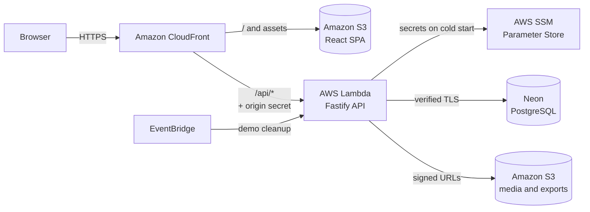

# Memorization

**[Leia em português / Read this in Portuguese](README.pt-BR.md)**

A spaced-repetition flashcard web app. A person creates **Cards**, groups them
into **Decks** and studies them in **Study sessions**, so that each Card comes
back right before it would be forgotten.

Built for the course **AGL11091 - Trends in Software Engineering** with
Spec-Driven Development through [GitHub Spec Kit](https://github.com/github/spec-kit):
every feature started from a specification in [`specs/`](specs/).

- **Application**: <https://memorization.joaolaureano.dev> (use “Sign in as Test” to try it without an account)
- **Presentation**: <https://claude.ai/artifact/JrKYwYHpCGipXnW7ePwKfN>

> The specs and the code use Portuguese domain terms (`Cartão`, `Baralho`,
> `Sessão de estudo`, `Usuário`). This README translates them.

## Features

- **Decks and Cards**: text, Image and Audio Cards, with search and filters.
- **Spaced repetition**: SM-2 with a four-level rating.
- **Temporary deck**: mix Cards from several Decks into one shuffled Session.
- **Study schedule**: weekly Routines per Deck and a week calendar.
- **Statistics and history**: hit rate, daily chart and every Session's record.
- **Anki export**: one or all Decks as `.apkg`, with media and review progress.
- **Test account**: a disposable account with three demo Decks, erased on sign-out.
- **Account**: sign up, sliding session, Password change and account deletion.
- **Interface**: Portuguese, English and Spanish; 360 to 1440 px, 200% zoom, keyboard and screen reader.

## Running locally

```bash
npm run demo   # at the root: installs, starts API (SQLite) and frontend, prints http://127.0.0.1:5173
```

Or each part on its own:

```bash
export SEGREDO_DAS_SENHAS="$(openssl rand -hex 32)"   # keep the same one for the same database
cd backend && npm install && npm run dev               # API on 127.0.0.1:3001
cd frontend && npm install && npm run dev
```

## Stack

| Layer | Technology |
|---|---|
| Language | TypeScript on Node.js 24+ |
| Backend | Fastify and Zod |
| Frontend | React with Vite |
| Persistence | One storage Port, two Adapters: SQLite locally, PostgreSQL (Neon) in the cloud |
| Tests | Vitest, Testing Library and Playwright (real browser, real API and database) |
| Infrastructure | AWS with OpenTofu; CI and deploy on GitHub Actions |
| Development | [Claude Code](https://claude.com/claude-code) as Architect; code written by AI workers |

## Architecture



- **CloudFront** is the single entry point: the SPA from S3, `/api/*` to the
  Lambda with an origin secret, without which the Lambda answers 403.
- **Lambda** runs the same API as the local mode.
- **Media** are uploaded and played by the browser through short-lived signed
  URLs; in local mode they are served from disk.
- **EventBridge** removes abandoned Test accounts once a day.
- **Migrations** run in the deploy workflow (`migrate:cloud`) before the code ships.

Deployment guide: [`backend/terraform/README.md`](backend/terraform/README.md).

## Constitution

The [constitution](.specify/memory/constitution.md) holds the rules every
feature follows: spec before code, verification over assertion, minimal
scope, no secrets in the repository and a test for every requirement.

## Verification

```bash
npm run verificar:ci   # at the root: gitleaks, backend (SQLite and PostgreSQL), frontend and e2e
```

## License

[MIT](LICENSE)
