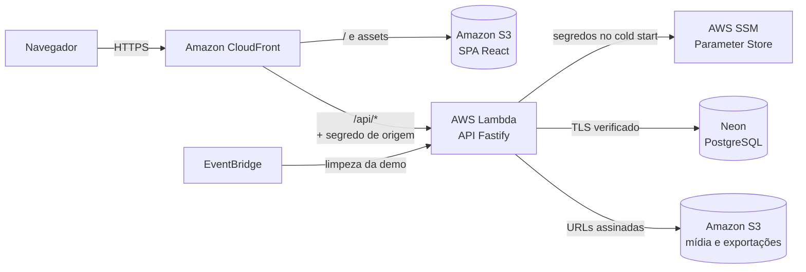

# Memorization

**[Read this in English / Leia em inglês](README.md)**

Aplicação web de estudo com cartões de memorização e repetição espaçada. A
pessoa cria **Cartões**, agrupa-os em **Baralhos** e estuda em **Sessões de
estudo**, para que cada Cartão volte pouco antes de ser esquecido.

Construído para a disciplina **AGL11091 - Tendências em Engenharia de
Software** com Spec-Driven Development pelo
[GitHub Spec Kit](https://github.com/github/spec-kit): toda feature nasceu de
uma especificação em [`specs/`](specs/).

- **Aplicação**: <https://d2mp2j3zeufjr0.cloudfront.net> (use «Entrar como Teste» para experimentar sem conta)
- **Apresentação**: <https://claude.ai/artifact/JrKYwYHpCGipXnW7ePwKfN>

## Funcionalidades

- **Baralhos e Cartões**: Cartões de texto, Imagem e Áudio, com busca e filtros.
- **Repetição espaçada**: SM-2 com avaliação em quatro níveis.
- **Baralho temporário**: junta Cartões de vários Baralhos numa Sessão embaralhada.
- **Agendamento**: Rotinas semanais por Baralho e calendário da semana.
- **Estatísticas e histórico**: taxa de acerto, gráfico diário e o registro de cada Sessão.
- **Exportação para Anki**: um ou todos os Baralhos em `.apkg`, com mídia e progresso.
- **Conta de teste**: conta descartável com três Baralhos de demonstração, apagada ao sair.
- **Conta**: criar conta, sessão deslizante, troca de Senha e exclusão da conta.
- **Interface**: português, inglês e espanhol; de 360 a 1440 px, zoom de 200%, teclado e leitor de tela.

## Rodar localmente

```bash
npm run demo   # na raiz: instala, sobe a API (SQLite) e o frontend e mostra http://127.0.0.1:5173
```

Ou cada parte separada:

```bash
export SEGREDO_DAS_SENHAS="$(openssl rand -hex 32)"   # use o mesmo para o mesmo banco
cd backend && npm install && npm run dev               # API em 127.0.0.1:3001
cd frontend && npm install && npm run dev
```

## Stack

| Camada | Tecnologia |
|---|---|
| Linguagem | TypeScript no Node.js 24+ |
| Backend | Fastify e Zod |
| Frontend | React com Vite |
| Persistência | Uma Porta de armazenamento, dois Adapters: SQLite local, PostgreSQL (Neon) na nuvem |
| Testes | Vitest, Testing Library e Playwright (navegador real, API e banco reais) |
| Infraestrutura | AWS com OpenTofu; CI e deploy no GitHub Actions |
| Desenvolvimento | [Claude Code](https://claude.com/claude-code) como Arquiteto; código escrito por workers de IA |

## Arquitetura



- **CloudFront** é a única entrada: a SPA vem do S3 e `/api/*` vai para a
  Lambda com um segredo de origem, sem o qual a Lambda responde 403.
- **Lambda** roda a mesma API do modo local.
- **Mídia** é enviada e tocada pelo navegador com URLs assinadas de curta
  duração; no modo local, vem do disco.
- **EventBridge** remove Contas de teste abandonadas uma vez por dia.
- **Migrações** rodam no workflow de deploy (`migrate:cloud`) antes do código.

Guia de implantação: [`backend/terraform/README.md`](backend/terraform/README.md).

## Constituição

A [constituição](.specify/memory/constitution.md) reúne as regras de toda
feature: spec antes do código, verificação em vez de afirmação, escopo mínimo,
nenhum segredo no repositório e um teste para cada requisito.

## Verificação

```bash
npm run verificar:ci   # na raiz: gitleaks, backend (SQLite e PostgreSQL), frontend e e2e
```

## Licença

[MIT](LICENSE)
